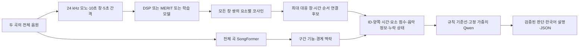

# music-similarity-xai

두 곡의 **전체 음원**에서 대응하는 시간 구간과 음악 요소별 유사성을 찾고, 구조화된 근거를 입력받은 로컬 Qwen이 한국어 판단을 작성하는 Python 과목 프로젝트 MVP다. 판단 대상은 **추가 검토에 필요한 음악적 유사성**이다.

소스는 사용자 요청에 따라 `src/`에 둔다. 아래 명령은 **저장소 루트**에서 실행한다. 원문 문헌은 `reference_files/`(로컬 보관, Git 제외), 외부 코드 고지는 [THIRD_PARTY_NOTICES.md](THIRD_PARTY_NOTICES.md), 모델·데이터 버전은 [MODEL_DATA_SOURCES.md](MODEL_DATA_SOURCES.md), 실제 검증 결과는 [docs/VALIDATION.md](docs/VALIDATION.md)에 있다.

## 설치

Python 3.10 권장. WAV/FLAC는 soundfile로 읽으며 MP3/M4A 등 추가 형식은 시스템 `ffmpeg`가 필요할 수 있다. 호스트 패키지를 공유하지 않는 가상환경을 권장한다.

```bash
python3 -m venv .venv
source .venv/bin/activate
python -m pip install -U pip wheel 'setuptools==75.8.2' 'packaging>=24'
# CPU 실행용 PyTorch. GPU 환경에서는 다음 줄 대신 아래 CUDA 설치 예제를 사용한다.
python -m pip install torch==2.6.0 --index-url https://download.pytorch.org/whl/cpu
python -m pip install -e '.[encoders,test]'
python -m pytest -q
```

GPU가 있는 환경에서는 해당 환경의 드라이버와 맞는 PyTorch 배포판을 설치한다. 아래는 CUDA 12.4용 예제다. 모델 크기와 구조는 CPU/GPU에서 같다.

```bash
python -m pip install torch==2.6.0 --index-url https://download.pytorch.org/whl/cu124
```

가중치 없이 실행할 때는 `pip install -e '.[test]'`로도 충분하다. 이 경로에서는 Transformers와 외부 모델 다운로드가 필요하지 않다.

## 합성 음원부터 JSON 보고서까지

```bash
python -m src synth --out data/synthetic
python -m src compare \
  data/synthetic/insertion/test/song_a.wav \
  data/synthetic/insertion/test/song_b.wav \
  --backend dsp --out results/demo/report.json
```

같은 실행을 `music-xai compare ...`로도 호출할 수 있다. `synth`는 원곡 12개를 먼저 train/validation/test로 나누고 변형 쌍 60개와 삽입 사례 3개를 생성한다. test 삽입 정답은 A **10–20초**, B **15–25초**다. 변형·구간·렌더링 후에 분할하지 않는다.

오프라인 MVP의 작은 학습·체크포인트 저장·재로딩·음원 추론·평가를 한 번에 실행하려면:

```bash
PYTHON=.venv/bin/python bash scripts/run_smoke.sh
```

## 분석 흐름과 출력



- `analyze_song`: 디코딩·리샘플링·전체 구간 인코딩·구조 분석.
- `compare_songs`: 모든 창 쌍의 코사인, 임계값 필터링, 시간 순서가 이어지는 후보 구성. 동일한 큰 후보 안에서도 가장 강한 개별 창을 보존한다.
- `judge_pair`: 동일한 근거를 규칙과 Qwen에 전달하고 스키마·근거 ID 검증. 표시 시간은 LLM 출력이 아닌 원본 근거에서 복사한다.

주요 JSON 필드는 `backend`, `songs`, `comparison.evidence`, `judgment`다. 각 근거에는 `evidence_id`, `a/b.start/end`, `factors`, `music_information`, `structure_context`가 있다. 마지막 창은 `actual_duration`, `padded_duration`, `padding_samples`를 구분하며 public 모델에는 실제 유효 음원만 입력한다. 코사인은 **[-1,1]의 비보정 점수**다. `unavailable`은 낮은 유사도가 아닌 누락 상태다.

판단 라벨은 `high_similarity`, `review`, `low_similarity`, `insufficient_evidence`다. Qwen 실패 시 보고서를 중단하는 대신 **`failed_rule_fallback`과 오류**를 남기고 규칙 결과를 표시한다. 이 결과를 Qwen 성공으로 집계하지 않는다.

| 백엔드 | 실제 사용하는 모델·정보 | 제공 범위와 한계 |
| --- | --- | --- |
| `dsp` | FFT 기반 음고 에너지·온셋·크로마 | 음정·리듬·화성·저음 프록시. 분리된 주선율·실제 베이스·검증된 코드가 아님을 표시. |
| `merit` | **MERT-v1-330M + 공식 공개 헤드** | **선율·리듬·음색**. 화성·반주/베이스·프레이즈 구조는 unavailable. 음색을 반주로 바꾸어 해석하지 않음. |
| `ours` | **공유 MERT-v1-95M + 네 시간축 헤드** | 음정 진행, 리듬, 화성, 반주/베이스. 각 헤드가 음악 정보 예측과 비교 임베딩을 함께 출력. `dsp` 특징으로 학습한 오프라인 smoke 모델은 메타데이터에서 별도로 구별. |
| SongFormer | 공식 전체 곡 추론 | 구간 기능·경계 맥락. 같은 chorus/verse라는 이유로 점수를 가산하지 않음. 세밀한 프레이즈 유사도는 아직 unavailable. |

## 공개 모델 준비와 첫 MERIT 비교

```bash
python scripts/prepare_models.py mert95 mert330 merit_heads
python -m src compare song_a.wav song_b.wav --backend merit --device cuda \
  --weights '{"melody":1,"rhythm":1,"timbre":0}' --out results/merit.json
```

CPU에서는 `--device cpu`를 사용한다. MERIT의 공식 층 `(3,4,5,6,23)`을 시간 평균 후 연결한 5120차원 특징에 3개의 128차원 공개 헤드를 적용한다. 음색 점수는 항상 출력하지만 기본 후보 선택 가중치는 0이다. 음악 요소와 별개인 음색이 전체 판단을 지배하지 않게 한 설정이며 원하는 가중치를 명시할 수 있다.

가중치·동적 모델 코드는 `configs/model_versions.json`의 고정 리비전으로 준비한다. 추론은 로컬 파일만 읽고, 공개 백엔드 로드 실패를 DSP로 숨겨 대체하지 않는다. MERT의 예전 `weight_norm` 직렬화 이름은 현재 이름으로만 바꾸며 누락·추가 가중치가 있으면 실패한다.

## 우리 모델의 소규모 학습과 본 학습

```bash
# 실제 95M 백본 고정 + 네 헤드. CPU에서 실행한 검증 규모.
python -m src train --manifest data/synthetic/manifest.json --backbone mert95 \
  --max-pairs 8 --epochs 2 --batch-size 2 --smoke --out checkpoints/mert95_smoke.pt
python -m src compare data/synthetic/insertion/test/song_a.wav \
  data/synthetic/insertion/test/song_b.wav --backend ours \
  --checkpoint checkpoints/mert95_smoke.pt --out results/ours.json

# 동일 백본·데이터·seed에서 음악 정보 예측 손실을 끈 ablation.
python -m src train --manifest data/synthetic/manifest.json --backbone mert95 \
  --max-pairs 8 --epochs 2 --batch-size 2 --prediction-weight 0 --smoke \
  --out checkpoints/mert95_ablation_smoke.pt

# 학습된 헤드에서 이어서 마지막 두 블록만 미세조정.
python -m src train --manifest data/synthetic/manifest.json --backbone mert95 \
  --init-checkpoint checkpoints/mert95_smoke.pt --unfreeze-last 2 \
  --max-pairs 2 --epochs 1 --batch-size 1 --smoke --out checkpoints/finetune_smoke.pt
```

원곡 데이터를 준비한 후 GPU 본 학습은 별도 명령으로 실행한다. 기본은 헤드 학습 30 epoch, 같은 조건의 ablation 30 epoch, 마지막 두 블록 미세조정 10 epoch다. 작은 smoke 실행은 본 학습 성능의 검증이 아니다.

```bash
PYTHON=.venv/bin/python DEVICE=cuda EPOCHS=30 \
  bash scripts/train_full.sh data/prepared/manifest.json
```

네 헤드는 시간축 Conv1d를 사용한다. 음악 정보 예측은 주선율/저음의 음고·온셋, 박/온셋, 크로마·가용 코드 근음/종류다. 음고 범위 MIDI 24–107 밖은 마스킹한다. MERT 프레임 특징은 20 Hz 정답 격자에 정렬한다. 손실은 **마스킹한 예측 손실 + 요소별 쌍 손실**이다. 예측 손실의 가중치가 0이면 학습하지 않은 정보 예측을 보고서에서 unavailable로 표시한다.

원곡 ID 누출을 검사하고 validation 손실로 체크포인트를 선택한다. test 집합으로 학습·선택하지 않는다. 고정 인코더 특징은 체크포인트 폴더의 `feature_cache_*`에 저장하며 메모리 캐시는 최대 128개다. 큰 코퍼스도 전체 WAV를 메모리에 쌓지 않고 구간을 읽는다. 백본·모델 버전·데이터 manifest·초기 체크포인트를 캐시 키에 포함한다. 마지막 두 블록을 해제할 때는 특징 캐시를 사용하지 않는다.

## 실제 데이터 준비

POP909는 공식 저장소의 `POP909/001/001.mid` 같은 경로를 사용한다. `MELODY`는 주선율, `PIANO`는 반주, `BRIDGE`는 보조 선율이다. `BRIDGE`를 곡 구조의 bridge 라벨로 쓰지 않는다. 별도 verse/chorus 주석이 있다면 `--structure-root`의 `<곡ID>.json`에 `[{"start":0,"end":12,"label":"verse"}]` 형식으로 제공한다.

```bash
python -m src prepare-real --pop909 /path/to/POP909-Dataset/POP909 \
  --out data/prepared
# 빠른 로더 검증은 --max-originals 12 --max-segments 2 추가.
```

Slakh는 공식 redux 분할을 함께 지정한다. 기존 분할의 중복 문제를 피하려고 redux 파일과 UUID 검사를 필수로 한다. 프로그램 번호 32–39의 비드럼 MIDI를 실제 베이스로 선택하고, 악기별 MIDI·스템 음원·mix 경로를 메타데이터로 보존한다. 없는 주선율·박·코드 정답은 생성해 채우지 않는다.

```bash
# slakh-utils의 고정 커밋은 THIRD_PARTY_NOTICES.md에 기록.
python -m src prepare-real --pop909 /path/to/POP909 \
  --slakh /path/to/slakh2100 --slakh-redux /path/to/slakh-utils/splits/redux.json \
  --out data/prepared_with_slakh
```

`prepare-real`은 MIDI를 동일한 oscillator로 렌더링해 통제 변형 쌍을 만든다. Slakh의 원래 mix/stem은 로더가 경로로 읽어 제공하며, 현재 학습 manifest에서는 **재렌더링한 MIDI 기반 쌍**을 사용한다. 실제 스템 녹음 조건에서의 학습·평가는 별도 검증 대상이다. 피아노 반주의 저음은 `piano_accompaniment_low_register_derived`, 실제 Slakh 베이스는 `actual_bass_midi`로 구별한다.

변형은 조옮김·전역 템포·악기 변화와 같은 코드/다른 선율의 어려운 음성(negative) 쌍이다. 조옮김한 절대 크로마처럼 의미가 달라지는 정답은 `null`로 마스킹한다. 합성 manifest에는 두 곡의 삽입 시간과 요소별 정답도 별도로 저장한다. 실제 데이터에서 모든 변형이 한 요소에만 작용한다고 가정하지 않는다.

실제 데이터의 음성 쌍에는 비균일 시간 변형·화성 진행 변경·베이스 패턴 변경도 포함한다. 해당 요소만 음성 라벨을 부여하고 영향을 함께 받을 수 있는 다른 요소는 마스킹한다. 단일 전역 이조처럼 의미가 불확실하거나 실제 변화가 없는 사례는 음성 정답으로 만들지 않는다.

BabySlakh처럼 파일이 있는데 메타데이터의 saved/rendered 플래그가 false인 배포본은 실제 파일을 읽고 `availability_warnings`에 불일치를 기록한다. 파일이 없는 정답을 채워 넣지 않는다.

## SongFormer와 Qwen

Slakh 로더만 소규모로 확인하려면 `python scripts/fetch_slakh_sample.py --out data/slakh_sample`로 공식 BabySlakh에서 첫 곡만 스트리밍 추출할 수 있다. `src.data.load_slakh`는 경로·MIDI를 읽고 `load_stem_audio(record, bass_only=True)`는 선택한 실제 베이스 스템을 24 kHz 모노로 디코딩한다. 첫 곡만으로 학습·검증·평가 분할을 새로 만들지는 않는다.

두 모델은 서로 다른 Transformers 버전을 요구하므로 별도 Python 환경으로 실행하고 JSON으로 통신한다. 다음은 CPU에서 검증한 버전이다. GPU용 PyTorch 인덱스는 위 설치 절차처럼 바꿀 수 있다.

```bash
python scripts/prepare_models.py songformer qwen

python3 -m venv .venv-songformer
.venv-songformer/bin/python -m pip install torch==2.4.0 torchaudio==2.4.0 torchvision==0.19.0 \
  --index-url https://download.pytorch.org/whl/cpu
.venv-songformer/bin/python -m pip install -r requirements/songformer.txt

python3 -m venv .venv-qwen
.venv-qwen/bin/python -m pip install torch==2.6.0 torchvision==0.21.0 \
  --index-url https://download.pytorch.org/whl/cpu
.venv-qwen/bin/python -m pip install -r requirements/qwen.txt

python -m src compare song_a.wav song_b.wav --backend ours --checkpoint checkpoints/mert95_smoke.pt \
  --songformer-python .venv-songformer/bin/python --judge qwen \
  --qwen-python .venv-qwen/bin/python --device cpu --out results/integrated.json
```

SongFormer 준비 시 내부 MusicFM의 Conformer **설정 파일만** 추가로 고정 다운로드한다. 공식 코드의 부동 Hub 조회를 이 로컬 설정으로 연결하며 추가 백본 가중치·모델 축소는 없다. 전체 음원 결과의 `start/end/label`을 검사한다. 예측한 구조 라벨 자체의 정답 여부는 별도 평가 대상이다.

Qwen에는 상위 근거 최대 3개의 ID·양쪽 시간·점수·예측 음악 정보·누락 상태를 전달한다. 비양자화 고정 가중치, `enable_thinking=False`, greedy 생성으로 실행한다. 원문 근거가 길면 창별 음악 정보는 첫 항목만 전달하므로 이 범위를 넘는 해석은 검토해야 한다. 응답 형식이 잘못되면 같은 모델에 최대 한 번 형식을 다시 요청하고 최초 실패와 재응답을 기록한다. **스키마/ID 검증은 설명 내용의 충실도까지 증명하지 않는다.**

Qwen 입력의 코사인은 소수 네 자리로 전달하고 원본 정밀도는 보고서에 보존한다. LLM이 시간을 잘못 합치거나 점수를 과장해 서술하는 오류를 막기 위해 `explanation`에서는 근거 ID 외 숫자를 허용하지 않는다. 정확한 시간과 점수는 원본 `comparison.evidence` 및 `cited_intervals`에서 읽는다. 이 검사는 질적인 서술의 충실도까지 보증하지 않는다.

## 평가

Qwen은 `lm-format-enforcer==0.11.3`으로 생성 토큰을 JSON 스키마에 맞게 제한한다. 허용된 라벨과 근거 ID만 생성할 수 있고 설명에는 숫자를 쓰지 않는다. 근거 ID는 `evidence_ids` 필드로 제공하며 모델 판단 자체는 코드에서 강제하지 않는다. 따라서 형식 검증률은 제약 디코딩을 사용한 실행 안정성 지표이며 음악적 판단 정확도와 구분한다.

```bash
python -m src evaluate --manifest data/synthetic/manifest.json --backend dsp --out results/dsp_eval.json
python -m src evaluate --manifest data/synthetic/manifest.json --backend merit --device cuda --out results/merit_eval.json
python -m src evaluate --manifest data/synthetic/manifest.json --backend ours \
  --checkpoint checkpoints/mert95_smoke.pt --out results/ours_eval.json
python -m src evaluate --manifest data/synthetic/manifest.json --backend dsp --judge qwen \
  --qwen-python .venv-qwen/bin/python --judge-cases 1 --out results/qwen_eval.json
```

평가는 요소별 ROC-AUC·고정 임계값 정확도·오탐률, 어려운 음성 쌍의 음정/선율 오탐과 전체 high 판정률, 삽입 구간의 **양쪽 최소 IoU**, top-1 IoU, 경계 오차를 출력한다. 정답이 한쪽뿐인 요소의 AUC는 `null`이다. 임계값을 조정할 때는 `--split validation`을 사용하고, 결정한 값으로 test를 한 번 평가한다. 기본 0.8은 보정된 판정 경계가 아니다.

Qwen은 같은 근거의 A/B 시간·음악 정보·맥락만 교환해 판단과 인용 ID의 일관성을 검사한다. 실패 후 규칙 결과를 Qwen 일관성 성공으로 세지 않는다. 이 검사는 **동일 근거 순서 교환**이며 전체 음원을 다시 비교했을 때 후보 선택까지 대칭이라는 보장은 아니다.

MERIT와 엄밀히 공통인 요소는 리듬이다. MERIT 선율과 우리 음정 진행은 부분적으로 비교하되 동일 과제로 간주하지 않는다. MERIT 음색을 반주/베이스와 비교하지 않는다. 합성 음원에서 관찰한 수치와 작은 학습의 높은 오탐률을 실제 음악 성능으로 일반화하지 않는다.

## 파일 구성

```text
src/                 음원·특징·공개 백엔드·모델·데이터·학습·비교·판단·평가·CLI
scripts/             고정 모델 준비, 분리 환경 worker, smoke 및 GPU 본 학습 명령
configs/             고정 모델 리비전과 라이선스 태그
requirements/        SongFormer와 Qwen의 별도 환경 의존성
tests/               시간·패딩·정답 마스크·누출·근거 ID·데이터 스키마 검사
third_party/licenses 원본 라이선스 고지
reference_files/     선행연구 원문·요약
docs/VALIDATION.md    실제 실행 명령·수치·검증 한계
```

데이터·체크포인트·캐시·실험 결과는 `data/`, `models/`, `checkpoints/`, `.cache/`, `results/`에 저장하고 Git에서 제외한다. 공개 녹음·POP909의 작은 예제를 별도로 준비하려면 `python scripts/fetch_reference_examples.py --out results/reference_examples`를 사용한다. 녹음 크레딧과 다운로드 SHA-256도 함께 기록한다.
