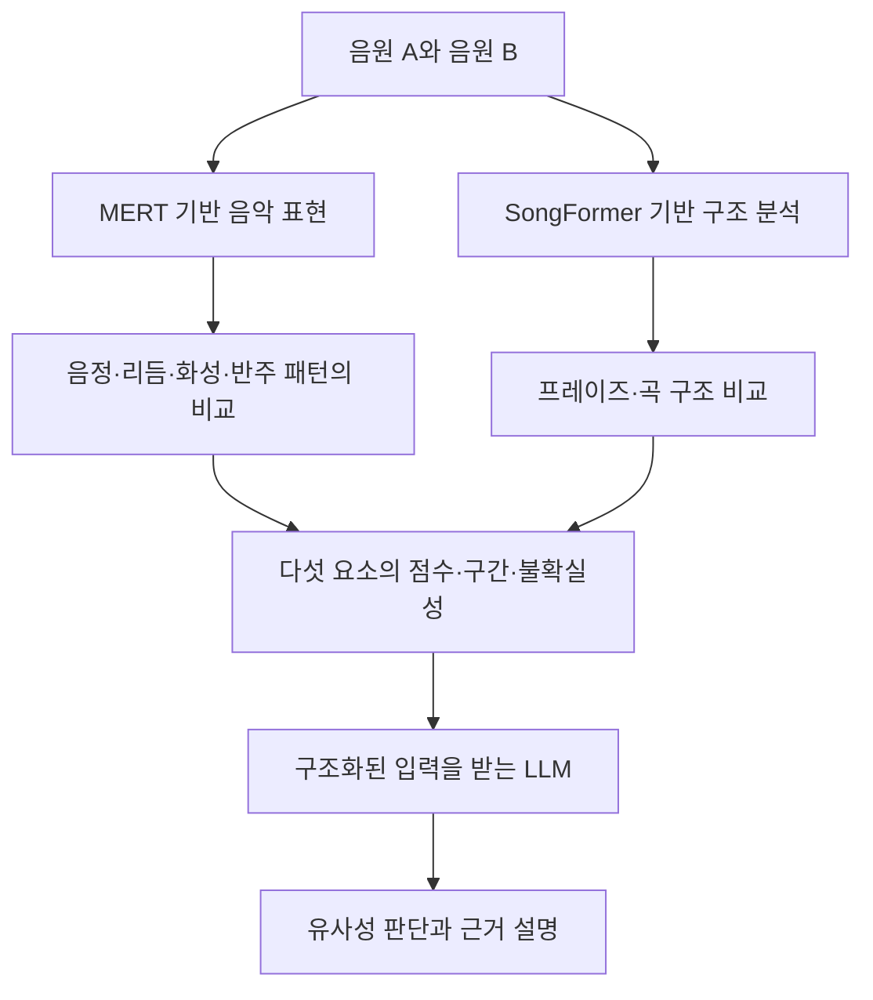

# 우리 연구와 선행연구의 연결

아래는 사용자가 제시한 연구 방향을 정리한 **설계 제안**이다. 이미 구현·검증한 시스템이나 선행연구의 보고 결과를 뜻하지 않는다.

## 시스템 구성

SongFormer만으로 세부 프레이즈 비교가 해결된다고 가정하지 않는다. 위 도식에서 LLM이 실제 판단을 수행할지, 별도 결정 모델의 판단을 설명할지는 구현 전에 정한다. 개념 병목을 주장하려면 최종 판단이 개념을 우회하는 입력을 받는지도 명시한다.

## 구성 요소별 근거

| 연구 구성 | 선행연구 | 활용 방향 | 아직 검증할 내용 |
| --- | --- | --- | --- |
| 연구 질문·전체 프레임워크 | [1번 메모](notes/01_hwang_music_plagiarism.md) | 인간 인식과 계산 모델의 연결 | 실제 모델과 인간 판단의 일치 |
| 요소별 인간 평가 | [2번 메모](notes/02_batlle_roca_matcha.md) | 속성별 판단과 비교 과제 | 우리 다섯 요소의 정의·주석 신뢰도 |
| 음악 표현 | [3번 메모](notes/03_li_mert.md) | MERT 기반 인코더 | 요소 분리와 부분 미세조정 효과 |
| 구조 분석 | [4번 메모](notes/04_hao_songformer.md) | 유사 구간의 위치·기능 | 세부 프레이즈 정렬과 구조 유사도 |
| LLM 입력 | [5번 메모](notes/05_fang_gpt_music_judge.md) | 음악 인식 출력을 기호·텍스트로 전달 | 소형 Qwen의 정확도와 입력 형식 영향 |
| 설명 가능한 판단 구조 | [6번 메모](notes/06_koh_concept_bottleneck.md) | 개념을 통한 판단과 개입 | 개념 우회 경로와 개입의 타당성 |
| 설명 평가 | [7번 메모](notes/07_turpin_unfaithful_explanations.md) | 근거에 대한 행동적 충실도 검사 | 입력에 없는 주장과 편향 민감도 |
| 통제 쌍 제작 | [8번 메모](notes/08_wang_pop909.md) | MIDI 기반 요소 변형 | 변형 간 간섭과 실제 음원 일반화 |

## 다섯 요소의 작업 정의안

| 요소 | 비교 대상의 예 | 정의할 사항 |
| --- | --- | --- |
| 음정 | 연속 음 사이의 간격·선율 윤곽 | 절대 음고와 이조 불변성을 구별 |
| 리듬 | 온셋 간격·길이 패턴·박자 위치 | 전체 템포 변화와 패턴 변화를 구별 |
| 화성 | 코드 진행·화성 리듬 | 조성 정규화와 코드 인식 오류 처리 |
| 반주 패턴 | 반주 음형·주기적 패턴 | 음색·실제 베이스 연주와의 경계 |
| 프레이즈·곡 구조 | 구절 경계·구간 반복·기능 | 짧은 프레이즈와 verse/chorus 수준을 분리 |

이는 연구용 정의 초안이다. MATCHA의 속성 체계와 동일하다고 표기하지 않는다. 빠진 요소를 억지로 점수화하지 말고 관측 불가·불확실을 표현할 수 있어야 한다.

## 평가 설계 초안

1. **데이터 분할:** 원곡 단위로 먼저 분할하고 변형본을 생성한다. 쌍의 파생 원곡이 평가 집합 밖에 존재하는지도 확인한다.
2. **요소 평가:** 각 요소의 보존·변경 여부와 예측 점수의 관계를 측정한다. 변형이 다른 요소까지 바꾸는 경우를 기록한다.
3. **인간 평가:** 요소별 판단과 전체 유사성 판단을 분리하고 평가자 간 일치도를 보고한다. 표절 인식 질문은 별도 항목으로 설계한다.
4. **모델 비교:** MERT 고정+학습 헤드, 부분 미세조정, 구조 모듈 유무를 비교한다. 동일한 데이터 분할을 유지한다.
5. **LLM 비교:** 구조화된 근거 입력 형식과 음악 개념 설명의 영향을 비교한다. 소형 Qwen의 결과를 선행연구에서 추정해 대체하지 않는다.
6. **설명 평가:** 근거 제거·변경, A/B 교환, 입력 근거와 출력 주장의 대응을 검사한다. 충실도와 문장 자연스러움을 별도로 보고한다.

정확한 점수 척도·임계값·평가지표는 정답 주석 형식과 최종 과제를 정한 뒤 선택한다. 현재 자료만으로 미검증 성능 수치나 최종 표절 판정 기준을 설정하지 않는다.
